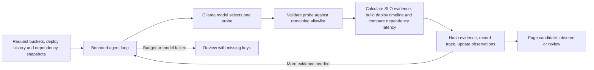

# LLM SRE Incident Investigation Agent

Investigate a checkout incident from request buckets, deployment changes, and dependency latency.

[Skills and verification](docs/ENGINEERING_NOTES.md)

## What I built

On-call triage needs to distinguish a measured breach from a gap in collection. This agent reconstructs evidence for one service and incident window.

The local language model selects one evidence probe per turn. The loop validates the returned action, executes the corresponding read-only function and sends the resulting observation back to the model. A deterministic domain policy consumes the validated evidence to produce the decision and source IDs. Missing required evidence yields review. The JSON report includes the trace and per-probe SHA-256 digests.

## Architecture



## Run the project

Use Python 3.9+ and Make from the repository root. Replay uses explicit scripted actions. Live mode requires a local Ollama server with the named model.

```sh
make verify
make demo
```

For model-backed execution, start `ollama serve` in a separate terminal. Then run:

```sh
ollama pull qwen2.5:0.5b
make live
```

The sample reports 36 errors from 900 requests, rollout deploy-v4, and payments latency above the configured threshold. The policy proposes a page for human review.

## Verification

Local Qwen2.5 0.5B through Ollama v0.40.16 selected `timeline → slo → coverage → dependencies` and returned `page_candidate`. The offline suite covers 5 cases. [Captured report](examples/live-report.json)

`make verify` runs the test suite and then compares each replay case’s decision, stop reason and citations against its expected outputs. For automated execution, use the [CI template](docs/github-actions/ci.yml).

The model also ran the `missing-minute` fixture and returned `review`.

To verify the decision in a local pipeline, run:

```sh
python3 agent.py run examples/main.json --replay examples/actions.json --require-decision page_candidate
```

A mismatched decision exits 1 and keeps the JSON report on stdout. Duplicate JSON keys exit 2 for fixtures and are rejected in the local model response.

## Operating limits

A rollout and degraded dependency provide leads for investigation. Their timing does not establish cause. A partial window, fewer than 100 requests, or missing dependency evidence requires review.

The model receives bounded summaries through a loopback API. The fixture reader caps inputs at 128 KiB. The model can select only named probes and supplies no tool arguments. Keep local fixtures within the intended data boundary.

[Architecture](docs/ARCHITECTURE.md) · [Case study](docs/CASE_STUDY.md) · [Runbook](docs/RUNBOOK.md) · [Troubleshooting](docs/TROUBLESHOOTING.md)

[Ollama structured outputs](https://docs.ollama.com/capabilities/structured-outputs)
